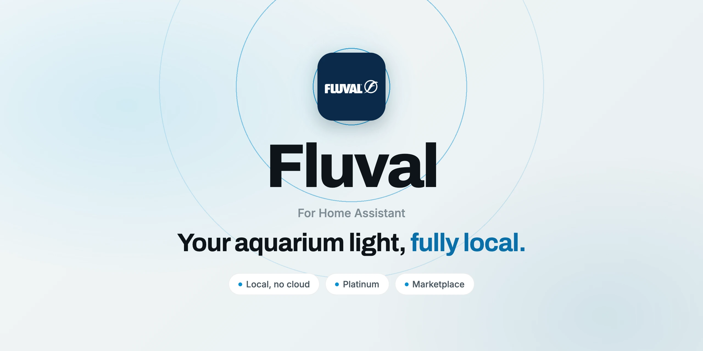

<div align="center">

<picture>
  <source media="(prefers-color-scheme: dark)" srcset="docs/images/readme-title-dark.webp" />
  
</picture>

[](https://github.com/SH1FT-W/fluval/releases/latest)
[](https://www.home-assistant.io)
[](https://hacs.xyz)

<a href="https://sh1ft-w.github.io/fluval"><b>Website</b></a>&emsp;<a href="#supported-lights">Lights</a>&emsp;<a href="#install">Install</a>&emsp;<a href="#set-up">Set up</a>&emsp;<a href="#entities">Entities</a>&emsp;<a href="CHANGELOG.md">Changelog</a>

</div>

<br/>

Your Fluval Reef or Plant 4.0 light in Home Assistant: **every channel as a slider, colours mixed from the real LED spectra, programs and effects written to the lamp.** Over Bluetooth, through a local adapter or ESPHome Bluetooth proxies, without cloud. Values always come from the lamp: without contact the entities are unavailable, never a guessed 0 %.

The light allows **only one Bluetooth connection**, so the FluvalConnect app and Home Assistant take turns. Fluval succeeds [MrMooreUK/fluvalble](https://github.com/MrMooreUK/fluvalble) with **the same domain `fluvalble`** and the same unique IDs: entities, history and automations stay when you [switch](#switching), and only one of the two can be installed at a time.

<a id="supported-lights"></a>
## Supported lights

The current Fluval Bluetooth generation with five channels on the FFF0 service. The model is detected from the product ID in the Bluetooth advertisement.

| Light | Product ID | Channels | Tested on hardware |
|:--|:--|:--|:--:|
| Reef Nano 4.0 LED | 547 | Pink, Cyan, Blue, Purple, Cold white | ✓ |
| Reef 4.0 LED | 546 | Pink, Cyan, Blue, Purple, Cold white | |
| A-Sky Aqua 1025mm | 385 | Pink, Cyan, Blue, Purple, Cold white | |
| Plant 4.0 LED | 545 | Pink, Blue, Cold white, Pure white, Warm white | |
| Plant Nano 4.0 LED | 548 | Pink, Blue, Cold white, Pure white, Warm white | |
| Plant PRO LED | 386 | Pink, Blue, Cold white, Pure white, Warm white | |
| Siena 2.0 | 563 | Pink, Blue, Cold white, Pure white, Warm white | |

The untested lights speak the same protocol as the Reef Nano 4.0, are built from the FluvalConnect app data and tested against a simulated lamp. Own one? Please [report](https://github.com/SH1FT-W/fluval/issues) whether it works, with the diagnostics file. Not supported: the older encrypted generation (Plant 3.0, Marine 3.0, AquaSky 2.0, Wing Nano, Vicenza, Venezia, Roma and others), AquaSky 3.0 (532) and Roma & Shaker 2.0 (564); for those, use MrMooreUK/fluvalble instead.

**New in 26.11:** save the lamp's professional program as named profiles and switch between them, and weather effects end properly after a restart. Every change is in the [changelog](CHANGELOG.md).

<a id="install"></a>
## Install

[](https://my.home-assistant.io/redirect/hacs_repository/?owner=SH1FT-W&repository=fluval&category=integration)

Search for **Fluval** under **Settings > Marketplace** (called HACS before Home Assistant 2026.11), download it and restart Home Assistant.

<details>
<summary>Install by hand</summary>

1. Download the [latest release](https://github.com/SH1FT-W/fluval/releases/latest).
2. Copy `custom_components/fluvalble` into `/config/custom_components/` and restart Home Assistant.

</details>

<a id="set-up"></a>
## Set up

Before you start, you need Bluetooth in range of the light: a local adapter or ESPHome Bluetooth proxies with active connections. Close the FluvalConnect app, it would hold the only connection.

1. **Add the light.** It usually shows up under **Settings > Devices & services > Discovered**. If not, choose **Add integration > Fluval Aquarium LED** and pick the light.
2. **Choose how to connect** under **three dots > Configure**. **Keep connected** (on by default) stays connected, is fast and holds the state; off, Home Assistant connects only briefly (every 5 minutes and for commands), so the app gets a turn. A **preferred proxy** is tried first; if it fails, another one is used and the preferred one again after 30 minutes.
3. **Weather, if you like.** In the same options, pick a weather entity for effects from weather.

The entry reloads when the options are saved. Once profiles exist, the options first ask whether to change settings or rename or delete a profile.

<a id="switching"></a>
### Switching from MrMooreUK/fluvalble

1. **Remove "Fluval Aquarium LED"** in the Marketplace. This deletes the old folder; the integration entry stays.
2. **Install this integration** and restart Home Assistant. The entry is taken over with entity IDs, history, device, automations and scripts. Of the four old options, **Keep connected** remains (on if the old active time was 0 = permanent).

`sensor.<name>_connection_mode` stays behind as "no longer provided" and can be deleted.

<a id="entities"></a>
## Entities

`<name>` is the device name in entity ID form; after switching, the existing prefix is kept. Names are in English and German.

| Entity | Shows |
|:--|:--|
| `light.<name>_light` | RGB mixed from the five channels, brightness, the lamp's effects, `transition`. Attribute `channels` with the real values in %. |
| `number.<name>_pink`, `_cyan`, `_blue`, `_purple`, `_cold_white` | Reef models: one channel each, 0 to 100 %. Above 0 switches on, all at 0 really switches off. |
| `number.<name>_pink`, `_blue`, `_cold_white`, `_pure_white`, `_warm_white` | Plant models, the same |
| `select.<name>_mode` | `manual` (Home Assistant decides the colour), `automatic` or `professional` (the lamp's program) |
| `select.<name>_profile` | Saved profiles. Picking one writes it into the lamp and switches to `professional`. Shows the one running. |
| `button.<name>_save_profile` | Save the professional program the lamp holds right now as a new profile |
| `switch.<name>_hold_state` | Home Assistant restores what it last set (late echoes, the lamp's own scene after power-on or a power cut), at most once a minute |

<details>
<summary>Weather, buttons and diagnostics (more entities)</summary>

| Entity | Shows |
|:--|:--|
| `select.<name>_weather_effects` | Off, thunderstorm only, thunderstorm and clouds: a storm outside plays lightning in the tank |
| `number.<name>_weather_effect_minutes` | Duration of a weather effect, 1 to 120 minutes |
| `button.<name>_identify`, `_sync_clock`, `_reconnect` | Blink the lamp, set its clock (also after every connect and daily), reconnect |
| `binary_sensor.<name>_reachable` | Diagnostic; attributes `gatt_connected`, `source`, `rssi`, `last_error` |
| `sensor.<name>_last_seen`, `_source`, `_signal_strength` | Diagnostic: connected since, through which proxy, signal |
| `sensor.<name>_timed_effects` | Diagnostic: timed effects stored in the lamp |

</details>

## Examples

All five channels in one command, as a ten-minute sunrise. Use the channel names of your model; missing ones stay as they are. One command, one confirmation, no intermediate state:

```yaml
action: fluvalble.set_channels
target:
  entity_id: light.reef_nano_light
data:
  pink: 22
  cyan: 77
  blue: 100
  purple: 66
  cold_white: 44
  transition: 600
```

<details>
<summary>What <code>light.turn_on</code> does</summary>

| Call | Result |
|:--|:--|
| no values | if it was off: the last mix, never a white flash; in `automatic` or `professional` only switch on |
| only `brightness` | current mix brighter or darker |
| `rgb_color` (+ `brightness`) | colour mixed from the five channels |
| `effect` | the lamp's effect (`crescent_moon`, `partly_cloudy`, `lightning`, `sun_and_lightning`); `off` returns to the mix |
| `light.turn_off` | off, the mix is kept |

RGB is an approximation: the lamp has five LED colours, not RGB LEDs. For exact values use the sliders or `set_channels`. During an effect the light shows only on or off. `transition` runs in steps every 2 seconds; a new command cancels it.

</details>

<details>
<summary>A daily schedule in the lamp with <code>fluvalble.set_pro_program</code></summary>

1 to 12 points, time and the channels from 0 to 100 % (missing ones = 0). The lamp fades between the points by itself and runs **without Home Assistant**. `activate` (default on) switches to `professional` afterwards.

```yaml
action: fluvalble.set_pro_program
target:
  entity_id: light.reef_nano_light
data:
  activate: true
  points:
    - { time: "08:00", blue: 10 }
    - { time: "10:00", pink: 22, cyan: 77, blue: 100, purple: 66, cold_white: 44 }
    - { time: "19:00", pink: 22, cyan: 77, blue: 100, purple: 66, cold_white: 44 }
    - { time: "21:00", blue: 5 }
```

</details>

<details>
<summary>Timed effects with <code>fluvalble.set_timed_effects</code></summary>

As in the app: up to 7 windows in which the lamp plays an effect by itself, stored in the lamp. An empty list deletes all.

```yaml
action: fluvalble.set_timed_effects
target:
  entity_id: light.reef_nano_light
data:
  windows:
    - start: "21:00"
      end: "21:30"
      effect: crescent_moon        # crescent_moon, partly_cloudy, lightning, sun_and_lightning
      weekdays: [fri, sat]         # mon … sun, leave out for every day
      enabled: true
```

</details>

<details>
<summary>Read the programs with <code>fluvalble.get_programs</code></summary>

```yaml
action: fluvalble.get_programs
target:
  entity_id: light.reef_nano_light
response_variable: programs
```

Returns `auto` (sunrise, sunset, ramps, sleep time, day and night values), `professional` (list of time and the five channels) and `timed_effects` (windows with effect and weekdays, 0 = Monday). If a command fails (lamp not reachable, no confirmation, invalid windows or points), any action stops with an error message.

</details>

<details>
<summary>Profiles</summary>

The FluvalConnect app keeps its profiles on the phone and the lamp stores only the active professional program, so Home Assistant keeps its own list:

1. **Pick a profile in the app** (or write one with `set_pro_program`). The app needs the only connection: switch off **Keep connected** or wait for a gap. **Hold state** switches the mode back, but the program stays in the lamp, so saving still works.
2. **Press Save program as profile.** It is saved as *Profile 1*, *Profile 2* … (up to 20, names up to 100 characters). A program already saved is not stored twice.
3. **Rename or delete** under **Options > Rename or delete a profile**.

The profile select shows the running profile when the mode is `professional` and the program in the lamp matches it, otherwise unknown. The app does not know these profiles; it simply shows the program that is in the lamp.

</details>

## Good to know

- **One connection only.** With **Keep connected** the FluvalConnect app cannot connect. For the app, switch the option off, or switch off **hold state** and disable the integration first.
- **Mode `manual`** is needed for Home Assistant to decide the colour; setting channels switches to it. In `automatic` and `professional` the lamp's program decides, and the sliders show what it sets right now.
- **Timed effects run inside the lamp.** If *timed effects* shows entries, the lamp may play effects by itself at those times.
- **Unavailable after 3 minutes** without an answer (12 without **Keep connected**). After 30 minutes a notice appears under **Repairs** and goes away once the lamp answers.

<details>
<summary>Troubleshooting</summary>

- **All entities "unavailable".** Is the FluvalConnect app connected on a phone? It holds the only connection. Otherwise check that a Bluetooth proxy nearby is online, then press **Reconnect** on the device page.
- **"The lamp did not accept the command".** The light reported something else even after one retry. Usually a program or effect of the lamp is running; check the mode and *timed effects*.
- **The light switches back by itself.** That is **hold state**. Switch it off to use the app.
- **Connection runs through the wrong proxy.** Choose a preferred proxy in the options; the *reachable* entity shows the current one in the attribute `source`.
- **Debug log:**

  ```yaml
  logger:
    logs:
      custom_components.fluvalble: debug
  ```

When you open an [issue](https://github.com/SH1FT-W/fluval/issues), attach the diagnostics (**Settings > Devices & services > Fluval Aquarium LED > three dots > Download diagnostics**: model, state, desired state, connection statistics and the last 30 events, MAC address and advertisement data redacted) and name your model.

</details>

<details>
<summary>Remove</summary>

1. **Settings > Devices & services > Fluval Aquarium LED > three dots > Delete.** The Bluetooth connection is closed; programs and timed effects stay stored in the lamp.
2. Remove the repository in the Marketplace (or delete `/config/custom_components/fluvalble`) and restart Home Assistant.

</details>

<details>
<summary>How it works</summary>

| Part | What it does |
|:--|:--|
| FFF0 service | Commands on FFF2, replies as notifications on FFF1, also through ESPHome Bluetooth proxies. One queue for all commands, firm time limits. |
| `D1` + CBOR | Mode, power, channels and effects as separate frames, like the app, then a state read as confirmation |
| `D2` state | The full state, split over several packets and put back together |
| Polling | On top of notifications: every 30 seconds while connected, every 5 minutes without **Keep connected**, less often after three failures (up to every 5 minutes) |

The protocol, product IDs and LED spectra come from the official FluvalConnect app and match [MrMooreUK/fluvalble](https://github.com/MrMooreUK/fluvalble). The product table, the spectrum tables and the colour fit are derived from that project (Apache 2.0, see [`NOTICE`](NOTICE)); connection, commands and state handling were written anew. Compared with the previous integration, the weekdays of timed effects are fixed (bit 0 = Sunday). Protocol notes are in [`CLAUDE.md`](CLAUDE.md) (German).

</details>

<details>
<summary>Development</summary>

```bash
python -m pytest -q -p no:logging --cov=custom_components/fluvalble   # simulated lamp in tests/conftest.py
uvx ruff check . && uvx ruff format --check .
uvx mypy@2.3.1 --python-executable <venv>/bin/python
python tools/pruefe-uebersetzungen.py    # strings.json against translations/*.json
```

Test requirements: `pip install -r requirements_test.txt`. The simulated lamp accepts commands like the real one, reports its state in 20-byte chunks and reproduces faults (out of range, drop while writing, hanging proxy, late replies, own scene on power-on). GitHub Actions runs the same checks plus HACS validation and hassfest. Quality scale: [self-assessed](custom_components/fluvalble/quality_scale.yaml).

</details>

## License

[Apache License 2.0](LICENSE), Copyright 2026 SH1FT-W. The predecessor and third-party material in [`NOTICE`](NOTICE).

<sub>Fluval (this integration) is an independent project, not affiliated with, endorsed or sponsored by Rolf C. Hagen Inc. Fluval is a trademark of Rolf C. Hagen Inc.</sub>
