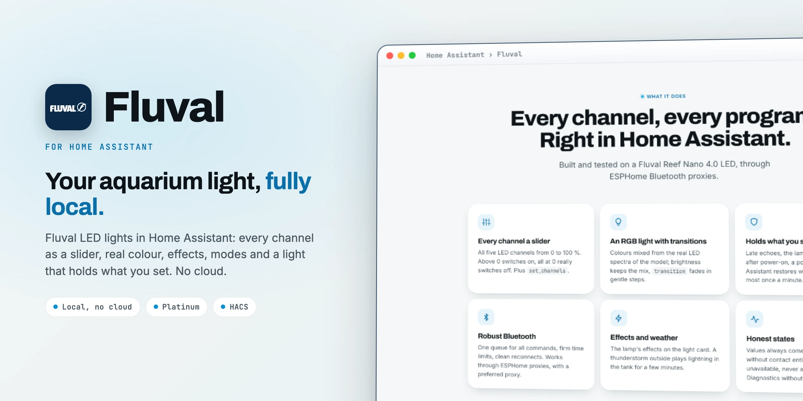

<div align="center">

<picture>
  <source media="(prefers-color-scheme: dark)" srcset="docs/images/readme-title-dark.webp" />
  
</picture>

<p>Local Bluetooth control for Fluval Reef and Plant 4.0 LED lights in Home Assistant.<br/>
Robust, honest states, no cloud.</p>

[](https://github.com/SH1FT-W/fluval/releases/latest)
[](https://www.home-assistant.io)
[](https://hacs.xyz)
[](https://developers.home-assistant.io/docs/creating_integration_manifest/#iot-class)
[](custom_components/fluvalble/quality_scale.yaml)
[](LICENSE)

<p><a href="https://sh1ft-w.github.io/fluval"><b>Website</b></a> &nbsp;·&nbsp; <a href="#new">New</a> &nbsp;·&nbsp; <a href="#features">Features</a> &nbsp;·&nbsp; <a href="#supported-lights">Supported lights</a> &nbsp;·&nbsp; <a href="#entities">Entities</a> &nbsp;·&nbsp; <a href="#installation">Install</a> &nbsp;·&nbsp; <a href="#troubleshooting">Troubleshooting</a> &nbsp;·&nbsp; <a href="CHANGELOG.md">Changelog</a></p>

</div>

<br/>

Fluval controls the LED lights of the current Fluval Bluetooth generation (Reef 4.0 and Plant 4.0 family) locally over Bluetooth, through a local adapter or ESPHome Bluetooth proxies. It was built and tested on a **Fluval Reef Nano 4.0 LED**.

It succeeds [MrMooreUK/fluvalble](https://github.com/MrMooreUK/fluvalble) and **uses the same domain `fluvalble` and the same unique IDs**, so entities, history, device, automations, scripts and dashboards stay the same when you switch. Because of the shared domain, **only one of the two integrations can be installed at a time.**

> [!NOTE]
> Fluval (this integration) is an independent project. It is not affiliated with, endorsed by or sponsored by Rolf C. Hagen Inc. Fluval is a trademark of Rolf C. Hagen Inc.

<br/>

<a id="new"></a>
<sub><b>JUST ARRIVED</b></sub>
## More lights of the same generation.

<!-- cards:new -->
<table>
<tr><td width="50%" valign="top"><picture><source media="(prefers-color-scheme: dark)" srcset="docs/images/icons/lightbulb-group-outline-dark.svg"></picture> <b>More Fluval lights</b> <code>26.10.3</code><br>Reef 4.0, Plant 4.0, Plant Nano 4.0, Plant PRO, Siena 2.0 and A-Sky Aqua join the Reef Nano 4.0. The model comes from the Bluetooth advertisement.</td><td width="50%" valign="top"><picture><source media="(prefers-color-scheme: dark)" srcset="docs/images/icons/palette-outline-dark.svg"></picture> <b>Plant channels and colours</b> <code>26.10.3</code><br>Plant models get Pink, Blue, Cold, Pure and Warm white, with colour mixing from their own LED spectra.</td></tr>
<tr><td width="50%" valign="top"><picture><source media="(prefers-color-scheme: dark)" srcset="docs/images/icons/signal-cellular-2-dark.svg"></picture> <b>Calmer signal updates</b> <code>26.10.2</code><br>Signal strength is written only on visible changes, odd confirmation replies are caught instead of raising errors.</td><td width="50%" valign="top"><picture><source media="(prefers-color-scheme: dark)" srcset="docs/images/icons/calendar-outline-dark.svg"></picture> <b>Calendar versions</b> <code>26.10.1</code><br>Year, month and the release of that month: 26.10.3 is the third release of October 2026.</td></tr>
</table>
<!-- /cards:new -->

Every change, release by release, in the [changelog](CHANGELOG.md).

<a id="features"></a>
## Features

<!-- cards:features -->
<table>
<tr><td width="50%" valign="top"><picture><source media="(prefers-color-scheme: dark)" srcset="docs/images/icons/tune-vertical-dark.svg"></picture> <b>Every channel a slider</b><br>All five LED channels from 0 to 100 %. A value above 0 switches on, all at 0 really switches off. Plus set_channels for all at once.</td><td width="50%" valign="top"><picture><source media="(prefers-color-scheme: dark)" srcset="docs/images/icons/lightbulb-on-outline-dark.svg"></picture> <b>An RGB light with transitions</b><br>Colours are mixed from the real LED spectra of the model. Brightness keeps the mix, transition fades in gentle steps.</td></tr>
<tr><td width="50%" valign="top"><picture><source media="(prefers-color-scheme: dark)" srcset="docs/images/icons/shield-check-outline-dark.svg"></picture> <b>Holds what you set</b><br>Late echoes, the lamp's own scene after power-on or a power cut: Home Assistant restores what it last set, at most once a minute.</td><td width="50%" valign="top"><picture><source media="(prefers-color-scheme: dark)" srcset="docs/images/icons/check-decagram-outline-dark.svg"></picture> <b>Honest states</b><br>Values always come from the lamp. Without contact entities are unavailable, never a guessed 0 %. Commands count only once confirmed.</td></tr>
<tr><td width="50%" valign="top"><picture><source media="(prefers-color-scheme: dark)" srcset="docs/images/icons/bluetooth-connect-dark.svg"></picture> <b>Robust Bluetooth</b><br>One queue for all commands, firm time limits, clean reconnects, backoff when the lamp is silent. Works through ESPHome proxies, with a preferred proxy.</td><td width="50%" valign="top"><picture><source media="(prefers-color-scheme: dark)" srcset="docs/images/icons/calendar-clock-dark.svg"></picture> <b>Programs in the lamp</b><br>Read the automatic and professional program, write a professional day schedule and up to seven timed effects. They run without Home Assistant.</td></tr>
<tr><td width="50%" valign="top"><picture><source media="(prefers-color-scheme: dark)" srcset="docs/images/icons/weather-lightning-dark.svg"></picture> <b>Effects and weather</b><br>The lamp's effects on the light card. With a weather entity, a thunderstorm outside plays lightning in the tank for a few minutes.</td><td width="50%" valign="top"><picture><source media="(prefers-color-scheme: dark)" srcset="docs/images/icons/stethoscope-dark.svg"></picture> <b>Diagnostics that help</b><br>Reachable with proxy, signal and last error, a repair issue after 30 minutes of silence and a diagnostics download without MAC address.</td></tr>
</table>
<!-- /cards:features -->

- **Switching on** without values brings back the last mix (never a flash of 100 % white); in automatic or professional mode it only switches on and the lamp's program decides the colour.
- **Transitions:** `transition` on the light and on `set_channels` runs in gentle steps (every 2 s); a new command cancels a running transition.
- **Clock:** set after every connect and daily, plus a button.
- **Repair issue:** if the lamp has not been reachable for 30 minutes, a notice appears under *Repairs* and disappears by itself once the lamp answers again.

<a id="supported-lights"></a>
## Supported lights

Lights of the **current Fluval Bluetooth generation with five channels on the FFF0 service**. The model is detected from the product ID in the Bluetooth advertisement.

| Light | Product ID | Channels | Status |
|---|---|---|---|
| Fluval Reef Nano 4.0 LED | 547 | Pink, Cyan, Blue, Purple, Cold white | **Tested** |
| Fluval Reef 4.0 LED | 546 | Pink, Cyan, Blue, Purple, Cold white | Supported, not tested on hardware |
| A-Sky Aqua 1025mm | 385 | Pink, Cyan, Blue, Purple, Cold white | Supported, not tested on hardware |
| Fluval Plant 4.0 LED | 545 | Pink, Blue, Cold white, Pure white, Warm white | Supported, not tested on hardware |
| Fluval Plant Nano 4.0 LED | 548 | Pink, Blue, Cold white, Pure white, Warm white | Supported, not tested on hardware |
| Fluval Plant PRO LED | 386 | Pink, Blue, Cold white, Pure white, Warm white | Supported, not tested on hardware |
| Fluval Siena 2.0 | 563 | Pink, Blue, Cold white, Pure white, Warm white | Supported, not tested on hardware |

"Supported, not tested on hardware" means: these lights speak the same protocol as the tested Reef Nano 4.0 and should work. They are built from the FluvalConnect app data and tested against a simulated lamp, but nobody has confirmed them on a real light yet. If you have one of these, please [report](https://github.com/SH1FT-W/fluval/issues) whether it works (with the diagnostics file).

**Not supported:** the older generation with the encrypted protocol (Plant 3.0, Marine 3.0, AquaSky 2.0, Wing Nano, Vicenza, Venezia, Roma and others), the AquaSky 3.0 (532, different protocol) and the Roma & Shaker 2.0 (564, four RGBW channels). For those, use [MrMooreUK/fluvalble](https://github.com/MrMooreUK/fluvalble).

<a id="entities"></a>
## Entities

<!-- cards:entities -->
<table>
<tr><td width="50%" valign="top"><picture><source media="(prefers-color-scheme: dark)" srcset="docs/images/icons/lightbulb-outline-dark.svg"></picture> <b>Light</b><br>light.<name>_light: RGB from the five channels, brightness, effects, transition. Attribute channels with the real values.</td><td width="50%" valign="top"><picture><source media="(prefers-color-scheme: dark)" srcset="docs/images/icons/tune-variant-dark.svg"></picture> <b>Channel numbers</b><br>Reef: pink, cyan, blue, purple, cold_white. Plant: pink, blue, cold_white, pure_white, warm_white. 0 to 100 % each.</td></tr>
<tr><td width="50%" valign="top"><picture><source media="(prefers-color-scheme: dark)" srcset="docs/images/icons/form-dropdown-dark.svg"></picture> <b>Mode and weather</b><br>mode (manual, automatic, professional), weather_effects and weather_effect_minutes.</td><td width="50%" valign="top"><picture><source media="(prefers-color-scheme: dark)" srcset="docs/images/icons/gesture-tap-button-dark.svg"></picture> <b>Buttons and switch</b><br>identify, sync_clock and reconnect. hold_state switches restoring the desired state on and off.</td></tr>
<tr><td width="50%" valign="top"><picture><source media="(prefers-color-scheme: dark)" srcset="docs/images/icons/information-outline-dark.svg"></picture> <b>Sensors</b><br>last_seen, source and signal_strength of the connection, timed_effects stored in the lamp.</td><td width="50%" valign="top"><picture><source media="(prefers-color-scheme: dark)" srcset="docs/images/icons/stethoscope-dark.svg"></picture> <b>Diagnostics</b><br>reachable with the attributes gatt_connected, source, rssi and last_error.</td></tr>
</table>
<!-- /cards:entities -->

`<name>` is the device name in entity ID form; when you switch from the previous integration, the existing prefix is kept. Entity names are available in English and German.

<details>
<summary>All entities</summary>

| Entity | Meaning |
|---|---|
| `light.<name>_light` | The lamp (RGB, effects, `transition`); attribute `channels` with the real channel values in % |
| `number.<name>_pink` / `_cyan` / `_blue` / `_purple` / `_cold_white` | Reef models: one channel each (0 to 100 %) |
| `number.<name>_pink` / `_blue` / `_cold_white` / `_pure_white` / `_warm_white` | Plant models: one channel each (0 to 100 %) |
| `select.<name>_mode` | `manual` (Home Assistant decides), `automatic`, `professional` (the lamp's program) |
| `switch.<name>_hold_state` | Hold state |
| `select.<name>_weather_effects` | Effects from weather: off, thunderstorm only, thunderstorm and clouds |
| `number.<name>_weather_effect_minutes` | Duration of a weather effect, 1 to 120 minutes |
| `button.<name>_identify` / `_sync_clock` / `_reconnect` | Blink the lamp, set its clock, reconnect |
| `binary_sensor.<name>_reachable` | Diagnostic: reachable; attributes `gatt_connected`, `source`, `rssi`, `last_error` |
| `sensor.<name>_last_seen` / `_source` / `_signal_strength` | Diagnostic: connected since, through which proxy, signal |
| `sensor.<name>_timed_effects` | Diagnostic: timed effects stored in the lamp |

</details>

### Light

| Call | Result |
|---|---|
| no values | if it was off: the last mix (never a white flash); in automatic or professional mode only switch on |
| only `brightness` | current mix brighter or darker |
| `rgb_color` (+ `brightness`) | colour mixed from the five channels |
| `effect` | the lamp's effect (`crescent_moon`, `partly_cloudy`, `lightning`, `sun_and_lightning`), `off` returns to the mix |
| `light.turn_off` | off, the mix is kept |

RGB is an approximation: the lamp has five LED colours, not RGB LEDs. For exact values use the channel sliders or `set_channels`. During an effect the light shows neither colour nor brightness, only on/off.

### Service `set_channels`

```yaml
action: fluvalble.set_channels
target:
  entity_id: light.reef_nano_light
data:
  pink: 22
  cyan: 77
  blue: 100
  purple: 66
  cold_white: 44
  transition: 600   # a ten-minute sunrise
```

Use the channel names of your model (Plant: `pink`, `blue`, `cold_white`, `pure_white`, `warm_white`). Missing channels stay as they are. All channels at 0 switch the lamp off, a value above 0 switches it on. For daylight routines this is better than five single `number.set_value` calls: one command, one confirmation, no intermediate state.

### Service `get_programs`

```yaml
action: fluvalble.get_programs
target:
  entity_id: light.reef_nano_light
response_variable: programs
```

Returns `auto` (sunrise, sunset, ramps, sleep time, day and night values), `professional` (list of time and the five channels) and `timed_effects` (windows with effect and weekdays, 0 = Monday).

### Service `set_timed_effects`

As in the app: up to 7 windows in which the lamp plays an effect by itself (stored in the lamp). An empty list deletes all.

```yaml
action: fluvalble.set_timed_effects
target:
  entity_id: light.reef_nano_light
data:
  windows:
    - start: "21:00"
      end: "21:30"
      effect: crescent_moon        # crescent_moon, partly_cloudy, lightning, sun_and_lightning
      weekdays: [fri, sat]         # mon … sun, leave out for every day
      enabled: true
```

### Service `set_pro_program`

Writes a daily schedule (1 to 12 points, time and the five channels from 0 to 100 %, missing channels = 0) as the professional program into the lamp. The lamp fades between the points by itself and then runs **without Home Assistant**. `activate` (default on) switches the mode to `professional` afterwards.

```yaml
action: fluvalble.set_pro_program
target:
  entity_id: light.reef_nano_light
data:
  activate: true
  points:
    - { time: "08:00", blue: 10 }
    - { time: "10:00", pink: 22, cyan: 77, blue: 100, purple: 66, cold_white: 44 }
    - { time: "19:00", pink: 22, cyan: 77, blue: 100, purple: 66, cold_white: 44 }
    - { time: "21:00", blue: 5 }
```

If a command fails (lamp not reachable, no confirmation, invalid windows or points), the action stops with an error message.

## Installation

### HACS (custom repository)

1. In HACS, open the three dots menu, choose **Custom repositories** and add `https://github.com/SH1FT-W/fluval` with the type **Integration**.
2. Search for **Fluval**, download it and restart Home Assistant.

### Manual

1. Download the [latest release](https://github.com/SH1FT-W/fluval/releases/latest).
2. Copy the folder `custom_components/fluvalble` into `/config/custom_components/` and restart Home Assistant.

Requires Home Assistant 2026.9 or newer and Bluetooth (a local adapter or ESPHome Bluetooth proxies with active connections).

## Setup

Supported lights are discovered automatically over Bluetooth. Otherwise: **Settings > Devices & services > Add integration > Fluval Aquarium LED** and pick the light. Close the FluvalConnect app first, the light allows only one Bluetooth connection.

### Options

| Option | Meaning |
|---|---|
| Keep connected | On (default): permanently connected, fast, the state is held. Off: connect only briefly (every 5 minutes and for commands), so the FluvalConnect app gets a turn. |
| Preferred proxy | Connect through this Bluetooth proxy first (signal in brackets if it sees the light). If that fails, another one is used and the preferred one is tried again after 30 minutes. |
| Weather for "effects from weather" | Weather entity for the *weather effects* select (off, thunderstorm only, thunderstorm and clouds). |

The entry reloads when saved. The weather effect duration and *hold state* are entities.

## Switching from MrMooreUK/fluvalble

1. In HACS, remove "Fluval Aquarium LED" (this deletes the old folder, the integration entry stays).
2. Install this integration (see above) and restart Home Assistant.
3. The existing entry is taken over: entity IDs, history, device, automations and scripts stay. Of the four old options, **Keep connected** remains (on if the old active time was 0 = permanent).

`sensor.<name>_connection_mode` stays behind as "no longer provided" (it only showed the option) and can be deleted.

## How the values stay current

The light reports changes by itself over Bluetooth notifications. In addition Home Assistant polls the state: every 30 seconds while connected, every 5 minutes without *keep connected*. After three failures in a row it polls less often (up to every 5 minutes). The last values stay valid for 3 minutes (12 minutes without *keep connected*), then the entities become *unavailable*. Advertisements of the light update the signal strength and, with *keep connected*, trigger a new connection attempt right away.

## Good to know

- **The light allows only one Bluetooth connection.** With *keep connected* (default) the FluvalConnect app cannot connect. For the app: switch the option off, or switch off **hold state** and disable the integration first.
- **Mode `manual`** is needed for Home Assistant to decide the colour. Setting channels switches to it automatically.
- **Timed effects** run inside the lamp. If *timed effects* shows entries, the lamp may play effects by itself at those times.
- **In `automatic` and `professional`** the lamp's program decides the colour; the sliders show what the program sets right now.

## Troubleshooting

- **All entities "unavailable".** Home Assistant has not heard from the light for 3 (or 12) minutes. Is the FluvalConnect app connected on a phone? It holds the only connection. Otherwise: is a Bluetooth proxy nearby online? Then press **Reconnect** on the device page.
- **"The lamp did not accept the command".** The light reported something else even after one retry. Usually a program or effect of the lamp is running; check the mode and *timed effects*.
- **The light switches back by itself.** That is *hold state*: Home Assistant restores what it last set. Switch it off to use the app.
- **Connection runs through the wrong proxy.** Choose a *preferred proxy* in the options; the *reachable* entity shows the current one in the attribute `source`.
- **Diagnostics:** **Settings > Devices & services > Fluval Aquarium LED > three dots > Download diagnostics**, with the detected model, state, desired state, connection statistics and the last 30 events; MAC address and advertisement data are redacted.
- **Debug log:**

  ```yaml
  logger:
    logs:
      custom_components.fluvalble: debug
  ```

When you open an [issue](https://github.com/SH1FT-W/fluval/issues), please attach the diagnostics file and name your model.

## Removal

1. **Settings > Devices & services > Fluval Aquarium LED > three dots > Delete.** The Bluetooth connection is closed; programs and timed effects stay stored in the lamp.
2. Delete the folder `/config/custom_components/fluvalble` (or remove the repository in HACS) and restart Home Assistant.

## How it works

<!-- cards:how -->
<table>
<tr><td width="33%" valign="top"><picture><source media="(prefers-color-scheme: dark)" srcset="docs/images/icons/bluetooth-dark.svg"></picture> <b>FFF0 service</b><br>Commands on FFF2, replies as notifications on FFF1, also through ESPHome Bluetooth proxies.</td><td width="33%" valign="top"><picture><source media="(prefers-color-scheme: dark)" srcset="docs/images/icons/code-braces-dark.svg"></picture> <b>D1 + CBOR</b><br>Mode, power, channels and effects as separate frames, like the app, then a state read as confirmation.</td><td width="33%" valign="top"><picture><source media="(prefers-color-scheme: dark)" srcset="docs/images/icons/sync-dark.svg"></picture> <b>D2 state</b><br>The full state, split over several packets and put back together, every 30 seconds and on every change.</td></tr>
</table>
<!-- /cards:how -->

The protocol (Bluetooth service FFF0, commands `D1` + CBOR, state `D2` + CBOR, clock `CD …`) and the product IDs and LED spectra come from the official FluvalConnect app and match [MrMooreUK/fluvalble](https://github.com/MrMooreUK/fluvalble). The product table, the spectrum tables and the colour fit are derived from that project (Apache 2.0, see [`NOTICE`](NOTICE)); connection, commands and state handling were written anew. Compared with the previous integration, the weekdays of timed effects are fixed (bit 0 = Sunday). Protocol notes are in [`CLAUDE.md`](CLAUDE.md) (German).

## Development

```bash
python -m pytest -q -p no:logging --cov=custom_components/fluvalble   # simulated lamp in tests/conftest.py
uvx ruff check . && uvx ruff format --check .
uvx mypy@2.3.1 --python-executable <venv>/bin/python
python tools/pruefe-uebersetzungen.py    # strings.json against translations/*.json
```

Install the test requirements with `pip install -r requirements_test.txt`. The tests run against a simulated lamp that accepts commands like the real one, reports its state in 20-byte chunks and reproduces faults (out of range, drop while writing, hanging proxy, late replies, own scene on power-on). The same checks run on GitHub Actions for every push and pull request, plus HACS validation and hassfest.

## License

[Apache License 2.0](LICENSE), Copyright 2026 SH1FT-W. See [`NOTICE`](NOTICE) for the predecessor, third-party material and trademarks.
